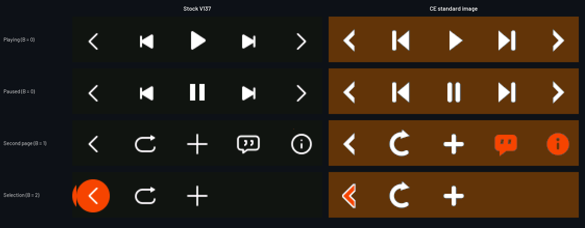
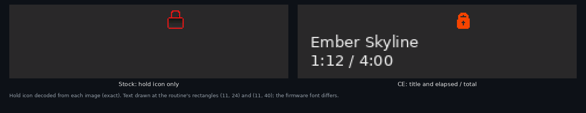
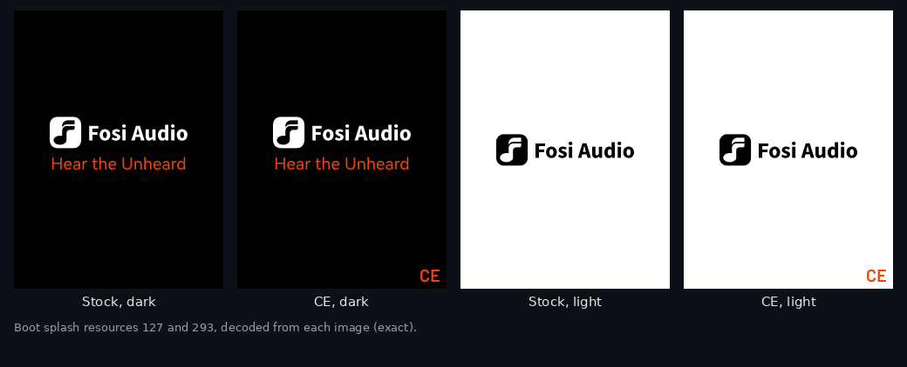
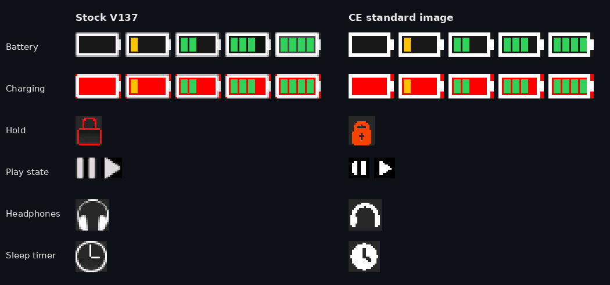
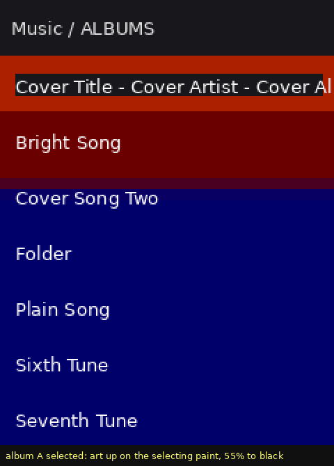
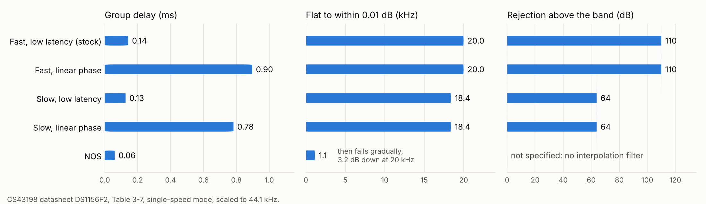
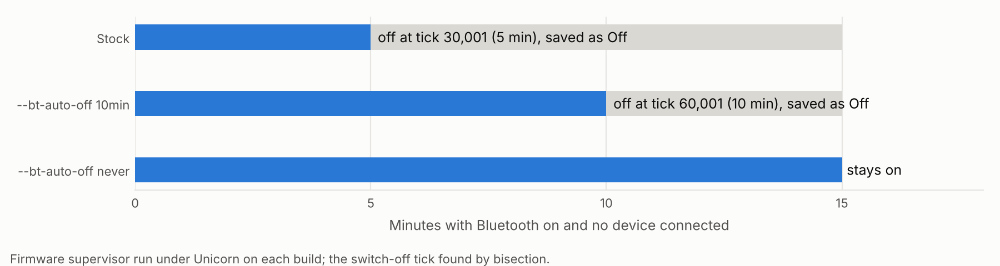

# Fosi DAP Neo CE

**CE (Community Edition) is patched firmware for the Fosi Audio DAP Neo.** It starts from the stock V137 update image and changes what the player draws, how it decodes and sorts music, and what it can play. Every change is a byte patch or module transplant with tests behind it, and CI rebuilds both CE images from source on every change.

> **Not yet tested on hardware.** No CE image has been flashed to a device. Each change passes host tests and Unicorn emulation of the firmware's own code, which is evidence, not proof. Read [Safety and recovery](#safety-and-recovery) and [`release/README.md`](release/README.md) before you install anything.

## Download

| Image | What it carries | SHA-256 |
|---|---|---|
| [`DP3_V137_CE.img`](release/DP3_V137_CE.img) | **Standard.** Everything below. 6,962 bytes longer than stock. | `9cc86655ddf23bddf72903b828e58f6b0a978836825e74c0f2a1a5056bdc98a3` |
| [`DP3_V137_CE_minimal.img`](release/DP3_V137_CE_minimal.img) | **Minimal.** Audio and library fixes only, same length as stock. | `623214370755053ed69dc53f0c7ae5ec0504bcb3e9ca6f2766cc9e9049101090` |
| [`DP3_V137_CE_recovery.img`](release/DP3_V137_CE_recovery.img) | Stock code dated one day after CE, for going back. | `aff851b31d6eee55cbd4bb3fc0464ac79f0039ee86ae6723225ac036a157d223` |

The easiest way to install is the [install page](https://cfong2001.github.io/Fosi_DAP_Neo_CE/): it checks the image's SHA-256 and copies it to the player for you.

Start with the standard image. Use the minimal one if the standard image does not install (no image longer than stock has been installed yet), or if you need WMA playback. [`release/README.md`](release/README.md) has the install steps, a testing order and recovery.

## Contents

- [Download](#download)
- [What you get](#what-you-get)
  - [Player](#player)
  - [Playlists](#playlists)
  - [Lock screen](#lock-screen)
  - [Splash, status icons, Bluetooth](#splash-status-icons-bluetooth)
  - [Sound](#sound)
  - [EQ](#eq)
  - [Library order](#library-order)
- [What CE changes](#what-ce-changes)
- [Variants and prototypes](#variants-and-prototypes)
- [Hardware status](#hardware-status)
- [Safety and recovery](#safety-and-recovery)
- [About this repository](#about-this-repository)
- [The stock firmware at a glance](#the-stock-firmware-at-a-glance)
- [Building](#building)
- [Design history](#design-history)
- [Documentation](#documentation)
  - [Container, boot, and storage](#container-boot-and-storage)
  - [Hardware and the audio path](#hardware-and-the-audio-path)
  - [Runtime: modules, events, and decoders](#runtime-modules-events-and-decoders)
  - [Research](#research)
  - [Patches](#patches)
  - [Tools](#tools)
- [Project status and open questions](#project-status-and-open-questions)
- [How this project works](#how-this-project-works)
- [Credits and licenses](#credits-and-licenses)

## What you get

Everything here is in the standard image; the minimal image has the sound and library changes except Opus. Figures are rendered from the firmware images by [`tools/render_readme.py`](tools/render_readme.py); controls and icons are the firmware's own pixels, and cover art and text are drawn.

### Player


The background takes its color from the album art, and the controls are drawn as clean glyphs on top of it instead of dark tiles.


Every cover gets its own background. Tracks without art use the theme default.



The controls in each player state, stock against CE.

### Playlists

Select an `.m3u` file in the browser to play it. Next, previous and shuffle stay inside the playlist (up to 59 tracks from up to 6 folders).

```
Albums/Ember Skyline/01 Opening.flac
Albums/Low Tide/03 Undertow.flac
Singles/Prism.ogg
```

### Lock screen



With hold on, the screen shows the track title and elapsed time.

### Splash, status icons, Bluetooth





A CE mark on the boot splash, redrawn status icons, and a long press of Power toggles Bluetooth.

### Sound


- Ogg Vorbis decodes at full precision: about 85 to 97 dB signal-to-noise instead of about 40.
- Opus files play (standard image; WMA no longer plays).
- Gapless playback between tracks of the same format.
- Lower decoder clocks, and volume no longer freezes after two DAC errors.

### EQ


The player's EQ is a 31-band graphic EQ, ±12 dB in 1 dB steps. Stock presets use five of the bands, and Classical, Bass Boost and Heavy Metal play Pop's curve, Jazz's curve and no EQ (left).

Build with your own curves and every preset gets its own one: paste an AutoEQ `GraphicEQ` file for your headphones, from autoeq.app, or type 31 dB values. Each curve is fitted to the firmware's own band filters (right: Sennheiser HD 600, within 0.9 dB). Presets you leave empty keep stock's curve. Available in the [builder](docs/) and as `build.py --eq-presets`; not in the downloads above. Details: [`patches/eq_presets/`](patches/eq_presets/).

### Library order

| Stock | CE |
|---|---|
| Abba | Abba |
| beck | The Beatles |
| The Beatles | beck |
| Track 1 | Éclair |
| Track 10 | Track 1 |
| Track 2 | Track 2 |
| track 3 | track 3 |
| Zappa | Track 10 |
| Éclair | Zappa |

Numbers sort by value, "The" is ignored, and case and accents don't split the list.

## What CE changes

Every change is a patch file or a module transplant applied by [`patches/framework/build.py`](patches/framework/build.py) to the hash-checked stock image. The standard image composes them with [`patches/full/build/build_full.py`](patches/full/build/build_full.py) and two small code insertions; the minimal image is the default framework set.

| Patches | Change | Standard | Minimal |
|---|---|:---:|:---:|
| 0001, 0002 | DAC error counter: consecutive failures, not a session total | ✓ | ✓ |
| 0003 to 0018 | Clock table v1: lower per-codec decoder clocks (data only) | ✓ | ✓ |
| 0020 to 0026 | Gapless fast path between same-codec tracks | ✓ | ✓ |
| 0027 to 0031 | Natural sort keys and comparator | ✓ | ✓ |
| 0050 | Wheel timer period 400 to 1000 µs | ✓ | ✓ |
| `vorbis75` transplant | Full-precision Vorbis with rounded output | ✓ | ✓ |
| `opus72` transplant, 5 classifier renames | Opus in place of WMA | ✓ | |
| title-copy, title-suffix | Track titles copied with a bound and always terminated | ✓ | |
| 0110 to 0117, 189 theme runs | Design refresh v4 transport glyphs, drawn keyed over a ground fill | ✓ | |
| 244 theme runs | Browser status icons | ✓ | |
| 64 theme runs | CE splash mark | ✓ | |
| 0100 to 0104, 0045, 0046 | Theater background, including the no-art reset | ✓ | |
| 0032 | Bluetooth on a long press of Power | ✓ | |
| 0040 to 0044, 0060 to 0062 | M3U playlists: browser import, playback hooks, exit on other playback | ✓ | |
| 0033 | Lock-screen title and time | ✓ | |

Patch 0000 is a no-op self-test fixture in both images. The standard image adds 6,962 bytes of code in modules 31 and 24 and fills 2,040 bytes of an unused gap in module 0; [`patches/full/README.md`](patches/full/README.md) maps where every byte lives. Evidence for the changes both images share:

| Change | What it does | Evidence |
|---|---|---|
| DAC error-counter fix (patches 0001 and 0002) | Stock counts total I2C errors per playback session and stops talking to the DAC after two, so two transient errors freeze volume and DAC control until a full stop. The fix counts consecutive failures instead. The dead-DAC protection is kept. | [`patches/dac_fix/dac_fix.md`](patches/dac_fix/dac_fix.md) |
| Clock table v1 (patches 0003 to 0018) | Per-codec decoder clock rows cut from the stock table (top row 480 MHz) to 144 MHz for MP3, WMA, AAC, and WAV, 240 MHz for Vorbis, and 288 MHz for FLAC, ALAC, APE, and DSD. Application-core fields are set to the values the stock solver floors at. Data only, no code changes. APE and DSD128 decode loads are unmeasured; see the hardware gate in [Hardware status](#hardware-status). | [`patches/clock_v1/clock_v1.md`](patches/clock_v1/clock_v1.md) |
| Full-precision Vorbis (module 75 transplant) | The low-precision Tremor build inside the stock OGG module is replaced with the full-precision build; stock runtime bytes and the module size (116,572 bytes) are unchanged. Single-file emulation: 45.1 dB SNR for stock, 85.5 dB for the transplant. On the pinned 40-file corpus: stock measures 38.1 to 42.1 dB, the transplant delivers 79.1 to 91.4 dB (median 81.2 dB), and the decoder arithmetic under the output stage measures 102 to 123 dB. No 16-bit output stage can pass 96 dB on this corpus; the round-to-nearest ceiling for these files is 85.1 to 97.4 dB. | [`patches/vorbis_swap/vorbis_swap.md`](patches/vorbis_swap/vorbis_swap.md), [`patches/vorbis_swap/DEPENDENCY.md`](patches/vorbis_swap/DEPENDENCY.md), [`patches/vorbis_swap/corpus/vorbis_corpus.md`](patches/vorbis_swap/corpus/vorbis_corpus.md) |
| Vorbis output rounding fix (part of the transplant) | The transplanted module's float to 16-bit conversion floored instead of rounding, a fixed 6.02 dB loss. A post-step in the transplant corrects the four conversion sites to round-to-nearest. After the fix, delivered quality sits at each corpus file's 16-bit ceiling (0.01 to 0.21 dB under it). | [`patches/vorbis_swap/vorbis_rounding.md`](patches/vorbis_swap/vorbis_rounding.md) |
| Gapless fast path (patches 0020 to 0026) | When the next track uses the same codec as the current one, the transition skips the decoder image copy, the decoder core reset, the parameter page copy, and the ready poll, and the per-transition settle delay is cut. Fixed saving is 85 ms per transition plus the copy and reset time, which is not measured until hardware. Patch 0026 arms the path; the build before it shipped the same code disarmed. Decoder side proven in the harness: a resident decoder accepted and decoded a second file bit-exact after end of stream, across a sample-rate change. The system side of the transition does not execute in the harness and is unobserved until hardware. | [`patches/gapless/gapless_patch.md`](patches/gapless/gapless_patch.md), [`patches/harness/milestone2.md`](patches/harness/milestone2.md) |
| Natural-sort keys (patches 0027 to 0031) | Library sort keys are built with case folding, Latin-1 accent folding, one leading "The " stripped, and digit runs compared as numbers. Stock uppercases ASCII in the first four characters only and compares the rest raw, so Track 10 sorts before Track 2. Both the key builders and the comparator are patched. Verified by a 4,000-pair consistency fuzz and a Unicorn differential test over 349 names, zero failures. | [`patches/sort_keys/sort_keys.md`](patches/sort_keys/sort_keys.md) |
| Wheel timer period (patch 0050) | The wheel sampling timer period goes from 400 microseconds to 1000 microseconds (2,500 wakes per second to 1,000). Keys are sampled on a separate SysTick path and are unaffected. Cost: worst-case wheel-step detection latency rises by about 1.2 ms, and the maximum trackable wheel speed drops. | [`patches/power/power.md`](patches/power/power.md) |

## Variants and prototypes

These are built and tested offline but are not in either image.

- **Browser marquee and cover background** ([`patches/browser_marquee/`](patches/browser_marquee/)). In the file browser the selected row's label grows to title, artist and album and scrolls after a one-second dwell, and the selected file's cover fills the screen behind the list, darkened for legibility. Captured from the emulated framebuffer:

  

  It needs 6,992 bytes in the browser's code area, which playlists and the lock screen already fill, so it ships as a separate build. It ranks ahead of focus mode for a future composition.
- **Focus mode** ([`patches/focus_mode/`](patches/focus_mode/)). The player hides its controls after five seconds and enlarges the cover; any key brings them back. It needs 340 bytes that stay resident while the player runs, and the standard image has 12.
- **EQ presets** ([`patches/eq_presets/`](patches/eq_presets/)). The stock EQ is a 31-band graphic EQ, but its presets use five bands, and Classical, Bass Boost and Heavy Metal play Pop's curve, Jazz's curve and no EQ. A build option fixes the preset selector and loads AutoEQ `GraphicEQ` files or custom curves into any preset, fitted to the firmware's own band filters.

  

- **DAC filter** ([`patches/dac_filter/`](patches/dac_filter/)). The CS43198 has five interpolation filters and stock code can select each one, but no menu offers the choice. A build option picks one of the other four: fast or slow roll-off, low latency or linear phase, or non-oversampling. It changes one byte and works with either image; the browser builder has it as a menu.

  

- **Bluetooth auto-off** ([`patches/bt_auto_off/`](patches/bt_auto_off/)). Stock turns Bluetooth off after 5 minutes with nothing connected and saves the setting as Off, so it doesn't come back after headphones were switched off for a while. A build option raises the limit to 10 minutes or removes it. Four bytes.

  

- **Battery profiles** ([`patches/power/`](patches/power/)). The apply routine and selector hooks exist, but no free settings item has been proven: the proposed id is the stock "20%" brightness label.

## Hardware status

No CE image has been flashed to a device. Every result in this repository is offline: Unicorn emulation, host-side tests, and structural validation of built images. The hardware phase has not started. Its first checks, in the order the documents queue them, are:

1. Read back the candidate firmware slot sectors over Rockusb and confirm the slot mapping before any write (see [Safety and recovery](#safety-and-recovery)).
2. The clock table v1 underrun gate: APE and DSD128 decode on hardware first, because those loads are unmeasured.
3. A canary build for the gap tail code home: pattern write, then mount, playback, library scan, and a settings save on the device, then a Rockusb read-back of the tail.
4. A window-cycle soak for the grown module 31 segment that carries the M3U and lock-screen code.
5. Observation of the armed gapless transition on the system side, which the decoder-side emulation harness cannot execute.

Quick checks that need only a device and headphones, no flashing tools beyond the normal install:

- Unplug headphones while playing: stock should pause ([`analysis/ui_controls.md`](analysis/ui_controls.md) §1.7).
- Leave Bluetooth on with nothing connected: stock turns it off after 5 minutes; a `--bt-auto-off` build should not ([`patches/bt_auto_off/`](patches/bt_auto_off/)).
- Pick Classical, Bass Boost and Heavy Metal on stock: they should sound like Pop, Jazz and no EQ; an `--eq-presets` build should give each its own curve ([`patches/eq_presets/`](patches/eq_presets/)).

Until those checks run, treat every image this project builds as unproven on hardware.

## Safety and recovery

Read this before considering any flash, including your own build:

- Nothing here has been tested on hardware. Treat every image as unproven until the hardware phase says otherwise.
- The slot validator boots the slot whose image has the strictly newer BCD header date; on a tie it boots slot 1. It checks a header marker and an unkeyed CRC and verifies no signature. Proven in [`analysis/boot_slots.md`](analysis/boot_slots.md) and [`analysis/flash_security_and_port.md`](analysis/flash_security_and_port.md).
- The planned layout is stock firmware in slot 1 and the CE build in slot 2. CE builds are stamped 2026-10-23, one day newer than stock (2026-10-22), so the validator selects slot 2 while slot 1 stays intact as the fallback.
- Software fallback: corrupting the slot 2 header returns the boot to stock in slot 1. The Rockchip USB (Rockusb) restore path is the hard recovery.
- Never let the stock update flow run on a dual-slot unit. The stock installer writes the update to slot 2 and then copies slot 2 over slot 1; it converges the slots by design and would erase the stock fallback. Keep update files off the card.
- The recovery image is unmodified stock bytes stamped one day newer than the CE build (default 2026-10-24), produced by `build.py --recovery`. Plain stock (2026-10-22) is older than the CE build and would not replace it under the validator rule; the recovery stamp is what makes the fallback installable.
- One mapping is still unproven: how Rockusb logical block addresses correspond to the validator's slot sectors. The first hardware task is a read-back comparison of the candidate sectors before any write.

## About this repository

The stock image is in the repository root, and every build refuses an input whose hash differs:

```
DP3_V137.img   13,631,492 bytes
SHA-256        fcc1cd3e35b46f1f8dbcb8da39fcc5eb3f1d469cdfade5e9c6ea3bd71ac6deef
```

Addresses and hashes refer to this stock version and no other. The standard image is reproduced from CE source with a pinned cross-toolchain ([`ci/REFERENCE_BUILD.md`](ci/REFERENCE_BUILD.md)). This compiles CE's own payloads and applies patches to the vendor binary; it does not rebuild the vendor's source. This project is not affiliated with Fosi Audio. The stock firmware remains the property of Fosi Audio and Rockchip.

## The stock firmware at a glance

The update package is a Rockchip RKnano firmware container, not a full flash dump. It holds 82 loadable modules for a dual-core ARM Cortex-M3 system (Rockchip RKnanoD family). One core runs the system and UI; the second core runs the audio decoders, which are complete standalone programs loaded per codec. The DAC is a Cirrus Logic CS43198 driven over I2C and I2S.

Facts that shape everything else in this repository, each proven from the binary and documented in the analysis set:

- The installer and the on-device slot validator check a header marker and an unkeyed CRC. Neither path verifies a digital signature.
- The device keeps two firmware slots and boots the valid slot with the newer header date. The stock update flow rewrites both slots, so a dual-slot setup needs its own discipline (see [Safety and recovery](#safety-and-recovery)).
- The settings block (SAVEINFO) is checksummed and mirrored; only part of it survives a save and load cycle verbatim, which constrains where new persistent settings can live.
- The stock Vorbis decoder is a low-precision Tremor build. Its output measures about 7 effective bits against a reference decode.
- Stock playback reloads and resets the decoder program on every track change, even within one codec. There is no prefetch and no second buffer. Gapless playback does not exist in stock and has to be built.

Start with [`analysis/platform_architecture.md`](analysis/platform_architecture.md) for the system layout and [`analysis/DP3_V137.md`](analysis/DP3_V137.md) for the container.

## Building

The framework lives in [`patches/framework/`](patches/framework/). `build.py` checks the input hash against the pinned stock SHA-256 before interpreting any byte, applies the manifest patches in order, applies the transplants with a refusal if a transplant range overlaps a byte patch, stamps the header date (default stock plus one day), validates the result, and writes the image plus a JSON build report. Three optional steps compose with the default build: `--grow` inserts a payload at the end of a module segment and recomputes every dependent offset (grown images validate with `tools/validate_grown.py`, because the stock validator pins the stock layout), and `--tail` delivers a resident payload of at most 2,044 bytes into the censused tail of the package gap after module 0's code, zero-filling the gap's workspace zone itself, and `--theme-config THEME.json` applies a theme exported by the theme studio (per-resource recolors with the studio's pixel counts checked against the image, plus raw runs edits; it refuses any overlap with the patches and transplants). `--dac-filter NAME` selects one of the DAC's four non-default interpolation filters (one byte, [`patches/dac_filter/`](patches/dac_filter/)), `--bt-auto-off 10min|never` lengthens or removes stock's 5-minute Bluetooth auto-off ([`patches/bt_auto_off/`](patches/bt_auto_off/)), and `--eq-presets CONFIG.json` loads AutoEQ or custom curves into the six EQ presets ([`patches/eq_presets/`](patches/eq_presets/)). `--recovery` emits the recovery image described above. `verify.py` runs fifteen checks over the build, including tamper refusal, reproducibility (two consecutive builds byte-identical), the combined-effects check that the unified image equals the disjoint union of its parts, isolation checks for the `--grow` and `--tail` steps, the theme check (pinned default, confined theme diffs, refusals), the opt-in Opus variant check, the theater and everything builds, and the DAC filter and Bluetooth auto-off options. `ci/build_release.sh` builds the release set from a clean checkout. Exact commands are in [`patches/framework/README.md`](patches/framework/README.md).

The browser CE builder in [`docs/`](docs/) builds images in the page with no local scripts or files: it can fetch the stock image from this repository (or take your own copy) and checks its SHA-256 before patching. Sound settings (EQ presets, DAC filter, Bluetooth auto-off) apply to every build; then choose **All CE features**, which reproduces the Standard image byte for byte, or **Pick features** from a grouped checklist that starts as the Minimal image. The Opus decoder data and the Bluetooth-shortcut and lock-screen routines are embedded in the page, generated by `docs/generate_builder_data.py` from the reference-toolchain builds and pinned by SHA-256. [`tests/builder.test.mjs`](tests/builder.test.mjs) checks the page engine byte for byte against framework images, and `tests/site-comparison.test.cjs` builds the Standard and Minimal images in a browser. The page is also usable from a local checkout.

One caution, recorded because an earlier step was built on the wrong premise: the base of the package gap (exec 0x03079C14) is live runtime workspace. The file descriptor table, the directory stack, and FAT driver fields live there. The build step that placed code at the gap base was removed; the `--tail` step only accepts payloads that land at exec 0x0307BFB4 or later. The census is in [`analysis/resident_home/resident_home.md`](analysis/resident_home/resident_home.md) and the full space accounting is in [`patches/framework/space_budget.md`](patches/framework/space_budget.md).

## Design history

The v4 glyphs in the standard image follow two earlier proposals that stayed on paper: [design refresh v2](patches/design_refresh_v2/design_v2.md) (Soft keys, keycap tiles) and [v3](patches/design_refresh_v3/design_v3.md) (a softened hand). Their sheets are on the [design-refresh-v3 release](https://github.com/cfong2001/Fosi-DAP-Neo-Firmware/releases/tag/design-refresh-v3). The theater algorithm is specified in [`patches/design_refresh_v2/theater_mode.md`](patches/design_refresh_v2/theater_mode.md), the v4 glyph set in [`patches/design_refresh_v4/design_v4.md`](patches/design_refresh_v4/design_v4.md), and the browser icons in [`patches/design_refresh_v4/browser_icons/design_browser.md`](patches/design_refresh_v4/browser_icons/design_browser.md). The theme studio in [`docs/`](docs/) builds custom color themes and previews theater mode.

## Documentation

### Container, boot, and storage

- [`analysis/DP3_V137.md`](analysis/DP3_V137.md): the update container, module records, memory map, resources, and integrity checks.
- [`analysis/block_device_dispatch.md`](analysis/block_device_dispatch.md): the storage callback table, read and write functions, and the logical sector offset.
- [`analysis/storage_stack.md`](analysis/storage_stack.md): the full storage stack, from the MMC controllers through the device-3 layer and its subdevice offsets.
- [`analysis/boot_slots.md`](analysis/boot_slots.md): slot validation and selection, the installer flow, and why the slots converge under stock updates.
- [`analysis/dual_slot_and_standalone_plan.md`](analysis/dual_slot_and_standalone_plan.md): the dual-slot operating plan and the road from patching stock to a standalone firmware.
- [`analysis/flash_security_and_port.md`](analysis/flash_security_and_port.md): what the installer and validator actually check, and what that means for modified images.
- [`analysis/resident_home/resident_home.md`](analysis/resident_home/resident_home.md): the census of candidate code homes, the refutation of the package gap base, and the two homes the builds use.

### Hardware and the audio path

- [`analysis/platform_architecture.md`](analysis/platform_architecture.md): SoC layout, both cores, memory, DAC, USB, storage, and the unresolved board questions.
- [`analysis/dac_audio_path.md`](analysis/dac_audio_path.md): the CS43198 path: I2C wiring, the 73-entry init table, volume and balance, and the per-session init behavior. The raw table is in [`analysis/dac_init_table.txt`](analysis/dac_init_table.txt).
- [`analysis/clock_table.md`](analysis/clock_table.md): the firmware clock table fully decoded, the frequency solver that consumes it, and the stock clock cost per codec.
- [`analysis/rknanod_trm.md`](analysis/rknanod_trm.md): what Rockchip's public RKNanoD reference manual settles: power domains, the SRAM map, the decode accelerators, clock dividers, UART and I2C limits, and the SAR-ADC.
- [`analysis/power_and_features.md`](analysis/power_and_features.md): power behavior, WFI anchors, and the battery measurement plan.
- [`analysis/usb_audio.md`](analysis/usb_audio.md): the USB audio function in module 11: descriptors, endpoints, and the ring buffer.
- [`analysis/usb_msc.md`](analysis/usb_msc.md): the USB mass storage function in module 12.

### Runtime: modules, events, and decoders

- [`analysis/module_catalog.md`](analysis/module_catalog.md): all 82 modules identified, with load addresses, sizes, and roles. Machine-readable version: [`analysis/module_catalog.json`](analysis/module_catalog.json).
- [`analysis/modules_round2.md`](analysis/modules_round2.md): the second-pass module work: the codec stub family, the Bluetooth window, recording, and the remaining unknowns.
- [`analysis/module22_selector.md`](analysis/module22_selector.md): the module 22 selector mechanism.
- [`analysis/core1_loader_protocol.md`](analysis/core1_loader_protocol.md): how the system core loads, resets, and talks to the decoder core: the loader, the message unit, and the file RPC protocol.
- [`analysis/event_flags.md`](analysis/event_flags.md): the firmware event bitmap: layout, post and test helpers, and known producers and consumers.
- [`analysis/ec_poster.md`](analysis/ec_poster.md): who posts the end-of-track event 0xEC, proven to two call sites in the module 0 playback monitor, and why gapless hooks belong there.
- [`analysis/saveinfo_lock.md`](analysis/saveinfo_lock.md) and [`analysis/saveinfo_and_lock.md`](analysis/saveinfo_and_lock.md): the SAVEINFO settings block, its save and load paths, the checksum, and which regions survive a save cycle. The lock display and hold behavior are covered here too.
- [`analysis/ui_controls.md`](analysis/ui_controls.md): input polling, the key mask function and its ADC bands, per-window key handling, and the status painter.
- [`analysis/gapless.md`](analysis/gapless.md): the stock track-transition path end to end, and the state a gapless transition must preserve.
- [`analysis/library_m3u.md`](analysis/library_m3u.md): the library database, its sort machinery, the CUE parser, and the absence of any playlist format in stock.
- [`analysis/vorbis_precision_test.md`](analysis/vorbis_precision_test.md): the test that proves the stock Vorbis decoder is the low-precision Tremor build, table by table.
- [`analysis/v137_update_feature_map.md`](analysis/v137_update_feature_map.md): the V137 update's features mapped to the code that implements them.
- [`analysis/feature_feasibility.md`](analysis/feature_feasibility.md): the six target features assessed against the binary evidence.
- [`analysis/neopod_xref.md`](analysis/neopod_xref.md): published NeoPod claims checked against this firmware, claim by claim.

### Research

The [`research/`](research/) folder records what already existed before this project wrote code, so the patch work builds on it instead of repeating it. Its own index is [`research/README.md`](research/README.md).

- [`research/community_landscape.md`](research/community_landscape.md): the modifier landscape for this device family: NeoPod, the Snowsky Echo firmwares, and what each one proves is possible.
- [`research/neopod_echopod.md`](research/neopod_echopod.md): a deep read of NeoPod and EchoPod: features, settings design, sorting rules, and license flags.
- [`research/patch_technique_and_sdk.md`](research/patch_technique_and_sdk.md): the nanitecfw patch technique and the leaked RKnanoD SDK as a ground-truth dictionary for the binary. The end of section 1.8 was lost to a truncation in its first commit and has been reconstructed from source material, marked at the seam (see [Project status](#project-status-and-open-questions)).
- [`research/performance_maximization.md`](research/performance_maximization.md): the performance targets for the CE build, the measured ceilings, and the claims register.
- [`research/external_sources_2026-11.md`](research/external_sources_2026-11.md): a second pass over external sources, each candidate scored for difficulty and reward. Top of the list is the DAC's five digital filters, which stock selects from a byte it never exposes.

### Patches

- [`patches/framework/README.md`](patches/framework/README.md): the patch format, the unified build, path configuration, and the verify suite.
- [`patches/framework/insert_tool.md`](patches/framework/insert_tool.md): the segment insertion rebuild behind `--grow`: the dependent-offset map, the four validation gates, and why grown images need a layout-generalized validator.
- [`patches/framework/space_budget.md`](patches/framework/space_budget.md): every code home in the firmware, its occupants, and its remaining room, plus the delivery mechanism allowed for each and the whole-firmware build accounting.
- [`patches/dac_fix/dac_fix.md`](patches/dac_fix/dac_fix.md): the DAC error-counter defect and its two-patch fix.
- [`patches/clock_v1/clock_v1.md`](patches/clock_v1/clock_v1.md): clock table v1: targets, the solver replica used to verify them, and the open flags.
- [`patches/vorbis_swap/vorbis_swap.md`](patches/vorbis_swap/vorbis_swap.md): the full-precision Vorbis transplant: how it was isolated, the ABI checks, and the emulation measurements. The tail of the document was lost to a truncation in its first commit and has been reconstructed from the build artifacts, marked at the seam (see [Project status](#project-status-and-open-questions)). Pins and provenance are in [`patches/vorbis_swap/DEPENDENCY.md`](patches/vorbis_swap/DEPENDENCY.md).
- [`patches/vorbis_swap/corpus/vorbis_corpus.md`](patches/vorbis_swap/corpus/vorbis_corpus.md): the 40-file finish-line measurement: delivered quality, the output-conversion decomposition, and the stock comparison.
- [`patches/vorbis_swap/vorbis_rounding.md`](patches/vorbis_swap/vorbis_rounding.md): the rounding fix: the four conversion sites, the register-level floor proof, and the harness-verified recovery to the 16-bit ceiling.
- [`patches/opus_swap/README.md`](patches/opus_swap/README.md): the opt-in Opus transplant that replaces WMA in module 72: the splice, the five classifier renames, the variant build command, and the gates that keep it out of the default build.
- [`patches/gapless/gapless_patch.md`](patches/gapless/gapless_patch.md): the gapless fast path as built: hook choice, the gate cave, the cost budget, and the arm gate.
- [`patches/sort_keys/sort_keys.md`](patches/sort_keys/sort_keys.md): the natural-sort transform, why both sides of the comparison had to change, and the differential test.
- [`patches/power/power.md`](patches/power/power.md): the wheel timer patch, the idle analysis (an honest negative: no idle WFI loop exists to patch), and the battery profiles design. The built profiles are in [`patches/power/build/`](patches/power/build/).
- [`patches/m3u/m3u_design.md`](patches/m3u/m3u_design.md): the M3U design: why no code caves exist, the resolution rules, and the parser core. Its original placement plan (a module 0 code-region extension) carries an erratum: that region is runtime workspace.
- [`patches/m3u/m3u_bridge.md`](patches/m3u/m3u_bridge.md) and [`patches/m3u/bridge_completion.md`](patches/m3u/bridge_completion.md): the browser bridge: the cluster-based browser identity, the registrar and file primitive pins, and the completed bridge against them.
- [`patches/m3u/resolver_design.md`](patches/m3u/resolver_design.md): the SRAM census, the descriptor registrar pin, and the track-resolver hook design for playlist playback.
- [`patches/ui_features/ui_features.md`](patches/ui_features/ui_features.md): the Bluetooth shortcut and the lock-screen work: the hold-state pins, the overlay residency proof, the dispatcher hook, and the remapping addendum.
- [`patches/dac_filter/README.md`](patches/dac_filter/README.md): the DAC filter option: the stock filter selector, the five CS43198 filters and the one-byte patch.
- [`patches/bt_auto_off/README.md`](patches/bt_auto_off/README.md): the Bluetooth auto-off option: the 5-minute supervisor limit, the 10 ms tick, and the supervisor emulation.
- [`patches/eq_presets/README.md`](patches/eq_presets/README.md): the stock 31-band EQ decoded, the preset selector bug, and fitting AutoEQ and custom curves to the firmware's band filters.
- [`patches/theme_editor/README.md`](patches/theme_editor/README.md): the theme studio and CE builder page, the catalog tooling, and the current state of theme support.
- [`patches/design_refresh_v2/design_v2.md`](patches/design_refresh_v2/design_v2.md): the design refresh v2 system: the Soft keys character, construction tokens, both schemes, and the icon mapping. Its sources and licence positions are in [`patches/design_refresh_v2/practice.md`](patches/design_refresh_v2/practice.md), and the album-art background design is in [`patches/design_refresh_v2/theater_mode.md`](patches/design_refresh_v2/theater_mode.md).
- [`patches/design_refresh_v3/design_v3.md`](patches/design_refresh_v3/design_v3.md): the soft sketch pass that supersedes the v2 hand: rounder forms, round-brush construction, a 1 px wobble budget, the native-size legibility gate, and the icon mapping. The v2 and v3 icon binaries are local-only and ship by the release-zip route, as v1 did.
- [`patches/harness/command_semantics.md`](patches/harness/command_semantics.md): the core-1 harness and the decoder command semantics it pinned down by execution.
- [`patches/harness/milestone2.md`](patches/harness/milestone2.md): harness milestone 2: bit-exact FLAC decode of whole files, and the decoder-side gapless transition trace.

### Tools

[`tools/`](tools/) holds the analysis tooling: image parsing and unpacking (`rknano_image.py`), the offline patcher primitives (`firmware_patch.py`), portable path resolution (`fosi_paths.py`), the module catalog generator (`gen_catalog.py`), the theme resource catalog tool (`ui_theme.py`), disassembly and cross-reference scanners, emulation checks of stock routines (`emu_dac.py`, `emu_bt_uart.py`), and Ghidra helper scripts under `tools/ghidra/`. Most tools need only Python 3 and the project venv (Capstone and Unicorn for the emulation work).

## Project status and open questions

Built and merged: the firmware map (all 82 modules), the patch framework and the unified build, the DAC fix, clock v1, the Vorbis transplant with its corpus measurement and rounding fix, natural-sort keys, the wheel timer patch, and the armed gapless fast path. Built and merged but not enabled in the default build: the Bluetooth shortcut, the M3U parser, bridge, resolver hooks, and module 31 composition, the lock-screen routine, and the battery profiles (see [Variants and prototypes](#variants-and-prototypes)). Also merged: the core-1 emulation harness (milestones 1 and 2: bit-exact FLAC PCM, the decoder-side gapless trace), the segment insertion rebuild (`--grow`), the gap tail step (`--tail`), the space budget, the theme build step (`--theme-config`, with the CE splash mark shipped as a runs config), the opt-in Opus variant build (not in the default build; `patches/opus_swap/`), the CE builder page in `docs/` (the theme studio with feature toggles, theme application, the CE mark toggle, and the gated-features list), and the design refresh v2 and v3 document sets (`patches/design_refresh_v2/`, `patches/design_refresh_v3/`). The everything image (`patches/full/`) composes the default build with Opus, design refresh v4 and the browser icons, theater mode, the Bluetooth shortcut, the lock screen and M3U playlists, and `.github/workflows/firmware.yml` rebuilds it and the release images from source on every pull request (`release/`). Also merged on 2026-11-08: three build options that leave the published images unchanged (`--dac-filter`, `--bt-auto-off`, and `--eq-presets` for AutoEQ and custom curves, which also fixes stock's preset selector), the Bluetooth UART verification from stock code, the headphone-unplug finding, and notes from Rockchip's public RKNanoD reference manual. The research that ranked them is [`research/external_sources_2026-11.md`](research/external_sources_2026-11.md).

Open, in the order they unblock other work:

1. Hardware phase: the five checks listed in [Hardware status](#hardware-status). Nothing else on this list can be settled without a device.
2. Battery profiles: identify a valid settings item and label, author the record, and resolve boot persistence, clock assumptions and hardware gates before enabling the hooks. The proposed 0xC5 ID collides with the stock brightness string.
3. Theme follow-through: the literal-site registry decision (the palette code sites the colour census pinned; approving them makes code-drawn colours themeable). Theater mode is a firmware feature in the everything image; its open question is whether any window other than the player calls the shared artwork setup. The design refresh v2 and v3 icon binaries are local-only and ship by the release-zip route, as v1 did.
4. Space decisions: focus mode (340 bytes) and the browser marquee (6,992 bytes) do not fit the everything image without removing a shipped feature. The trade-offs are listed in [`patches/full/README.md`](patches/full/README.md#space-decisions-for-the-owner).
5. Smaller open items: the FS type 3 enumeration contract (blocks M3U support on those volumes), a library enumeration order (blocks parser stage 3), and the contents of the decoder parameter page past the two known fields.

Documentation damage, repaired: two documents were truncated in their original commits, with a literal truncation marker baked in where text was lost. `research/patch_technique_and_sdk.md` lost the end of section 1.8 (the marker's character count overstated the loss; it measured the lost working context, not file bytes), and `patches/vorbis_swap/vorbis_swap.md` lost its tail, including the residual-risks section. No verbatim originals survive anywhere. Both were reconstructed on 2026-10-31 from the project's source material (the reference clones in the research set, the build artifacts, and the recorded measurements), and each reconstruction is marked at its seam inside the document.

## How this project works

- Evidence order: original machine instructions over decompiler output, execution over inference, and every claim labelled proven, likely, or open. Numbers that other work depends on are pinned with hashes.
- Destructive steps stay separate from analysis. Nothing is flashed as part of a research task, and modified images are built only by the framework from a hash-verified stock input.
- Work lands as feature branches and pull requests, one feature per PR, squash-merged after a coordinator review that re-runs the verification evidence. A worker report is a claim, not a result, until it is checked.
- Documentation follows the unslop standard: plain words, no inflated claims, sources named.

Contributions are welcome on those terms: an issue that reports a measurement, a PR that adds a verified patch or corrects a document with evidence, or a trace from real hardware once units are in hand.

## Credits and licenses

This project is not affiliated with Fosi Audio.

- The full-precision Vorbis library is Tremor, (c) Xiph.Org Foundation, BSD-style license. The module surgery that isolated it comes from berettavexee's echo-mini-opus project, BSD-3-Clause.
- The patch technique follows nanitecfw (MIT), written for the Echo Nano. The M3U parser is original code informed by EchoPod and NeoPod (GPL-3.0) logic and credits them in its header.
- NeoPod by danielNZ27 is the only prior modification work for this exact device, and the restore tool from the same author supplied the stock image used here.
- The leaked RKnanoD SDK is proprietary Rockchip material. It is used as a reference dictionary only; none of it is reproduced in this repository.
- The stock firmware remains Fosi Audio and Rockchip property. This repository contains analysis and patches, not their firmware.

