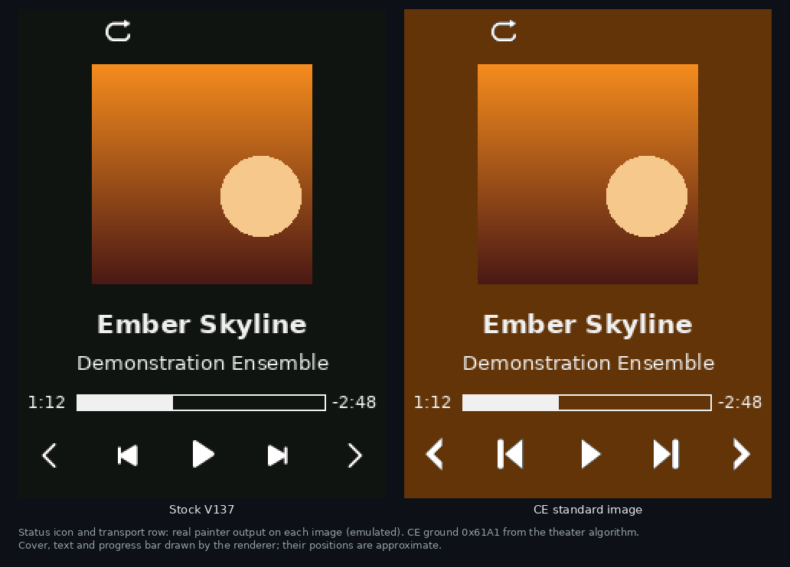
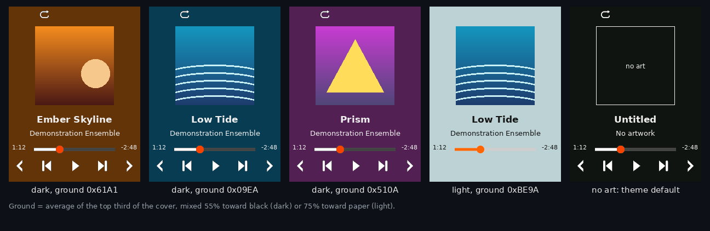
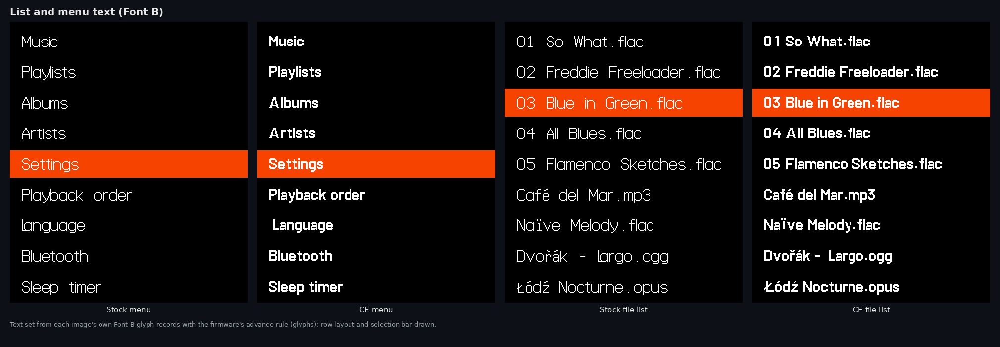
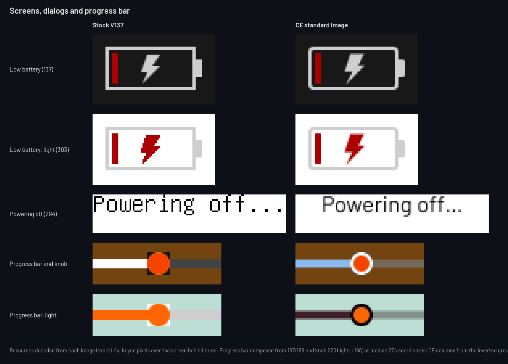
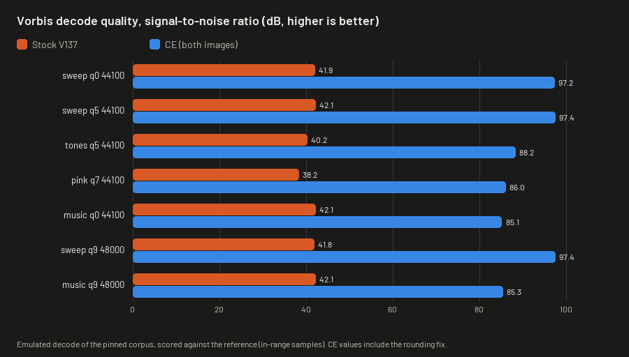
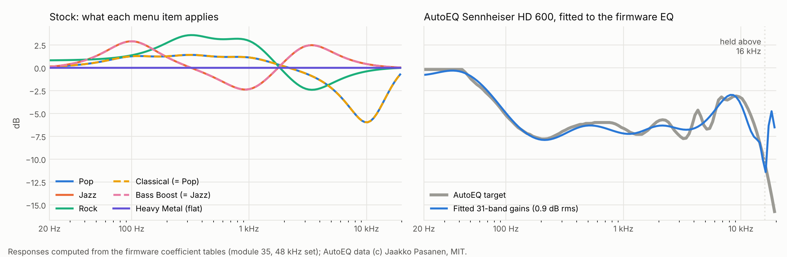

# Fosi DAP Neo CE

CE (Community Edition) is patched firmware for the Fosi Audio DAP Neo. It starts from the stock V137 update image and changes what the player draws, how it decodes and sorts music, and what it can play. Every change is a byte patch or module transplant with tests behind it, and CI rebuilds the release images from source on every change.

> **Not yet tested on hardware.** No CE image has been flashed to a device. Each change passes host tests and Unicorn emulation of the firmware's own code, which is evidence, not proof. Read [Safety and recovery](#safety-and-recovery) before you install anything.



- [Install](#install)
- [Features](#features)
- [Build options and variants](#build-options-and-variants)
- [The configuration site](#the-configuration-site)
- [Building from source](#building-from-source)
- [Reverse engineering](#reverse-engineering)
- [Safety and recovery](#safety-and-recovery)
- [Status and open work](#status-and-open-work)
- [Contributing](#contributing)
- [Credits and licenses](#credits-and-licenses)

## Install

| Image | What it carries | SHA-256 |
|---|---|---|
| [`DP3_V137_CE.img`](release/DP3_V137_CE.img) | Standard: every feature below. 7,168 bytes longer than stock. | `9c68d11152b997c24d301837d6f17f118d2075b46523b23f7c1bf2a5c308e99a` |
| [`DP3_V137_CE_minimal.img`](release/DP3_V137_CE_minimal.img) | Minimal: audio and library fixes only, same length as stock. | `0dfd10e23749f9b6c65499266f1a7a2ec038160b089ba0fc2ca68dcf2b24c986` |
| [`DP3_V137_CE_recovery.img`](release/DP3_V137_CE_recovery.img) | Stock code dated one day after CE, for going back. | `aff851b31d6eee55cbd4bb3fc0464ac79f0039ee86ae6723225ac036a157d223` |

Start with the standard image. Use the minimal one if the standard image does not install (no image longer than stock has been installed yet), or if you play WMA files.

The [install page](https://cfong2001.github.io/Fosi_DAP_Neo_CE/) checks the image's SHA-256 and copies it to the player's storage as `RKNANOFWIMG`; you then run the update on the device. To do it by hand, rename the image to `RKNANOFWIMG` (no extension), copy it to the top level of the player's storage, run the update the way you would an official Fosi update, and delete the file afterwards. [`release/README.md`](release/README.md) has the full steps, a testing order and recovery.

## Features

Everything here is in the standard image; the minimal image has the sound and library changes except Opus. Figures are rendered from the firmware images by [`tools/render_readme.py`](tools/render_readme.py): controls and icons are the firmware's own pixels, while cover art and text are drawn.



- Theater mode takes the player background from the album art; tracks without art use the theme default. The transport controls are drawn as glyphs over that background instead of dark tiles.
- Ogg Vorbis decodes at full precision: about 85 to 97 dB signal-to-noise against a reference decode, where stock measures about 40.
- Opus files play in place of WMA (standard image only).
- Track changes are much shorter. When a track ends and the next is the same format, the decoder stays loaded and running and the next track starts warm. Stock silences the first three decoded buffers of every track to hide a cold decoder's start-up, about 78 ms for MP3 and up to about 279 ms for FLAC; CE skips that, and the system-side work before the next track's audio starts drops from about 20.5 ms to 4.7 ms in emulation. This is not sample-exact gapless playback: the decoder still opens the next file after the last one ends.
- The library sorts naturally: numbers by value, a leading "The" ignored, and case and accents no longer splitting the list.
- Selecting an `.m3u` file in the browser plays it as a playlist; next, previous and shuffle stay inside it (up to 59 tracks from up to 6 folders).
- With hold on, the lock screen shows the track title and elapsed time.
- A long press of Power turns Bluetooth on or off. The status icons are redrawn, and the boot splash carries a CE mark.
- The menu and list font is redrawn from Barlow SemiBold. It is still 1-bit, because the firmware draws text without grey levels, but strokes are two pixels wide and the spacing is even. Stock spacing let `L` run into the next letter; that is fixed. Accented Latin letters are redrawn too; other scripts keep their stock glyphs.
- Icons and baked screen art are antialiased. The transport, status, battery and browser icons, the dialog cards, the low-battery and power-off screens, the CE splash mark and the progress bar carry smoothed edges in their pixels, so curves, diagonals and text no longer step. Art on a solid ground blends exactly into it. Art over the album-derived background (the transport glyphs and the progress bar and knob) blends toward a neutral grey.
- Volume no longer freezes after two DAC errors, decoder clocks are lower, and the wheel timer wakes less often.







More figures: [transport controls in each player state](media/transport.png), [lock screen](media/lockscreen.png), [boot splash](media/splash.png), [status icons](media/browser_icons.png), [every antialiased icon](patches/antialias/mock/icons_before_after.png), [full screens](patches/antialias/mock/screens_before_after.png), [list font close-up](patches/antialias/mock/font_before_after.png).

Every change is a patch file or a module transplant that [`patches/framework/build.py`](patches/framework/build.py) applies to the hash-checked stock image. The standard image composes them with [`patches/full/build/build_full.py`](patches/full/build/build_full.py), adding 6,962 bytes of code in modules 31 and 24, 206 bytes of padding before the header copy, and filling 2,040 bytes of an unused gap in module 0; [`patches/full/README.md`](patches/full/README.md) maps where every byte lives.

| Patches | Change | Standard | Minimal | Evidence |
|---|---|:---:|:---:|---|
| 0001, 0002 | DAC error counter counts consecutive I2C failures instead of a session total, so two transient errors no longer freeze volume until a full stop | ✓ | ✓ | [`dac_fix.md`](patches/dac_fix/dac_fix.md) |
| 0003 to 0018 | Clock table v1: per-codec decoder clocks lowered from the stock table (top row 480 MHz) to 144 MHz for MP3, WMA, AAC and WAV, 240 MHz for the lower Vorbis tiers and 288 MHz for FLAC. APE, ALAC, DSD and the top Vorbis tier keep stock's 480 MHz, above the 260 to 400 MHz Rockchip's SDK uses for them, until their loads are measured; data only | ✓ | ✓ | [`clock_v1.md`](patches/clock_v1/clock_v1.md) |
| 0019 to 0026, 0034 | Gapless fast path: at a natural end of track the decoder core keeps running, and a same-format next track skips the decoder reload, reset and boot and the three silenced start-up buffers; the DAC bus I2C reset hold drops from 1 ms to 50 µs (seven DAC writes per track change) | ✓ | ✓ | [`gapless/`](patches/gapless/README.md) |
| 0027 to 0031 | Natural-sort keys and comparator: case and Latin-1 accent folding, one leading "The " stripped, digit runs compared as numbers | ✓ | ✓ | [`sort_keys.md`](patches/sort_keys/sort_keys.md) |
| 0050 | Wheel timer period 400 to 1000 µs (2,500 to 1,000 wakes per second) | ✓ | ✓ | [`power.md`](patches/power/power.md) |
| `vorbis75` transplant | Full-precision Tremor in place of the stock low-precision build, with output rounded to nearest | ✓ | ✓ | [`vorbis_swap.md`](patches/vorbis_swap/vorbis_swap.md), [`vorbis_rounding.md`](patches/vorbis_swap/vorbis_rounding.md) |
| `opus72` transplant, 5 renames | Opus in place of WMA | ✓ | | [`opus_swap/`](patches/opus_swap/README.md) |
| title-copy, title-suffix | Track titles copied with a bound and always terminated | ✓ | | [`full/`](patches/full/README.md) |
| 0110 to 0117, 182 theme runs | Design refresh v4 transport glyphs, drawn keyed over the background, with baked antialiasing | ✓ | | [`design_v4.md`](patches/design_refresh_v4/design_v4.md) |
| 300 theme runs | Browser and status icons (antialiased) | ✓ | | [`design_browser.md`](patches/design_refresh_v4/browser_icons/design_browser.md) |
| 4 theme runs | Light-theme play-mode icons keyed, so they sit on the theater background | ✓ | | [`play_mode_light/`](patches/design_refresh_v4/play_mode_light/generate.py) |
| 40 theme runs | CE splash mark, antialiased | ✓ | | [`theme_editor/`](patches/theme_editor/README.md) |
| 314 theme runs | List and menu font (Font B) Latin glyphs redrawn from Barlow SemiBold | ✓ | | [`antialias/`](patches/antialias/README.md#shipped-the-list-and-menu-font) |
| 0118, 429 theme runs | Antialiased dialog corners, low-battery icon, "Powering off…" text and progress bar; the progress knob is drawn keyed, so it sits on the theater background without a square | ✓ | | [`antialias/`](patches/antialias/README.md) |
| 0100 to 0104, 0045, 0046 | Theater background, including the no-art reset | ✓ | | [`theater_mode.md`](patches/design_refresh_v2/theater_mode.md) |
| 0032 | Bluetooth on a long press of Power | ✓ | | [`ui_features.md`](patches/ui_features/ui_features.md) |
| 0040 to 0044, 0060 to 0062 | M3U playlists: browser import, playback hooks, exit on other playback | ✓ | | [`m3u_design.md`](patches/m3u/m3u_design.md) |
| 0033 | Lock-screen title and time | ✓ | | [`ui_features.md`](patches/ui_features/ui_features.md) |

Patch 0000 is a no-op self-test fixture in both images. The measurements behind the table, in brief:

- Vorbis: on a pinned 40-file corpus, stock measures 38.1 to 42.1 dB and the transplant 79.1 to 91.4 dB. Its float-to-16-bit conversion floored instead of rounding, a fixed 6.02 dB loss; after the rounding fix, delivered quality sits 0.01 to 0.21 dB under each file's 16-bit ceiling of 85.1 to 97.4 dB (no 16-bit output stage can pass 96 dB on this corpus). The module size (116,572 bytes) is unchanged. Details: [`vorbis_corpus.md`](patches/vorbis_swap/corpus/vorbis_corpus.md); pins and provenance: [`DEPENDENCY.md`](patches/vorbis_swap/DEPENDENCY.md).
- Gapless: the decoder side is proven in the core-1 harness (a resident decoder decoded a second file bit-exact after end of stream). The system side runs in the transition rig ([`patches/gapless/rig/`](patches/gapless/rig/)): with a 0.05 ms decoder reply and 8 MB/s storage, the I2S restart comes 4.7 ms after the end-of-track event against 20.5 ms on stock. Running the real playback monitor after the transition shows stock zeroing three decoded buffers and CE zeroing none, for FLAC, MP3 and APE alike. The rig also showed that the first armed release never released the decoder core from the reset the stock stop path puts it in, stalling same-format track changes for about 27 s; this release fixes that. Decoder-side open and first-frame decode time are not in those figures and need hardware.
- Natural sort: a 4,000-pair consistency fuzz and a Unicorn differential test over 349 names, with zero failures.
- Clock table: every lowered row stays above Rockchip's SDK figure for its format. APE, ALAC, DSD and top-tier Vorbis decode loads are unmeasured, so those rows keep stock clocks until a hardware check.
- Wheel timer: worst-case wheel-step latency rises by about 1.2 ms. Keys use a separate SysTick path and are unaffected.

## Build options and variants

These build options leave the published images unchanged. Each works with either image, from `build.py` or the [configuration site](#the-configuration-site).

| Option | What it does | Flag | Details |
|---|---|---|---|
| EQ presets | The EQ is 31 bands at ±12 dB, but stock presets use five bands, and Classical, Bass Boost and Heavy Metal play Pop's curve, Jazz's curve and no EQ. This fixes the selector and loads an AutoEQ `GraphicEQ` file or 31 dB values into any preset, fitted to the firmware's band filters. | `--eq-presets CONFIG.json` | [`eq_presets/`](patches/eq_presets/README.md) |
| DAC filter | The CS43198 has five interpolation filters and stock code can select each one, but no menu offers the choice. Pick one of the other four. One byte. | `--dac-filter NAME` | [`dac_filter/`](patches/dac_filter/README.md) |
| Bluetooth auto-off | Stock turns Bluetooth off after 5 minutes with nothing connected and saves it as Off. Raise the limit to 10 minutes or remove it. Four bytes. | `--bt-auto-off 10min\|never` | [`bt_auto_off/`](patches/bt_auto_off/README.md) |



On the right, a Sennheiser HD 600 curve fitted within 0.9 dB. More figures: [DAC filter responses](media/dac_filters.png), [Bluetooth on-time](media/bt_auto_off.png).

Built and tested offline, but not in either image:

- The browser marquee ([`browser_marquee/`](patches/browser_marquee/)): the selected file's label grows to title, artist and album and scrolls after a one-second dwell, over the file's cover. It needs 6,992 bytes in the browser's code area, which playlists and the lock screen already fill. [Emulated capture](media/marquee_v5.gif).
- Focus mode ([`focus_mode/`](patches/focus_mode/)): the player hides its controls after five seconds and enlarges the cover. It needs 340 resident bytes; the standard image has 12 left. Unused stock code in module 0 could hold it once a hardware check clears that space (see [Building from source](#building-from-source)).
- Battery profiles ([`power/`](patches/power/)): the apply routine and selector hooks exist, but no free settings item has been proven.

## The configuration site

[cfong2001.github.io/Fosi_DAP_Neo_CE](https://cfong2001.github.io/Fosi_DAP_Neo_CE/) runs entirely in the browser; nothing is uploaded. Its source is [`docs/`](docs/).

- Install: choose an image, then copy it to the player as `RKNANOFWIMG` (Chrome and Edge, through the File System Access API) or download it. Each image is fetched from `release/` and refused unless its length and SHA-256 match the pins in [`docs/install-data.mjs`](docs/install-data.mjs); a copy is read back and checked.
- Builder: set the EQ presets, DAC filter and Bluetooth auto-off, then build either all CE features, which reproduces the standard image byte for byte, or a picked set from a grouped checklist that starts as the minimal image. The stock image can be fetched from this repository or taken from your own copy. The Opus data and the Bluetooth and lock-screen routines are embedded in the page and pinned by SHA-256.
- Simulator: stock and CE screens side by side, drawn from each image's real resource pixels; the status icon and transport row replay what each image's player code draws, checked against emulation word for word. Dark and light themes, theater mode with your own cover art, no-media and boot-splash screens.
- Theme studio: inspect all 456 RGB565 resources and export exact colour rules as `theme.json` for `build.py --theme-config` or the builder.

Illustrations on the page are built with [Stageshow](https://github.com/benjitaylor/skills) in [`site/`](site/README.md). [`tests/builder.test.mjs`](tests/builder.test.mjs) checks the page's build engine against the Python framework byte for byte, and [`tests/site-comparison.test.cjs`](tests/site-comparison.test.cjs) runs the install flow, simulator and builder in Chromium.

## Building from source

The stock image is in the repository root, and every build refuses an input whose hash differs:

```
DP3_V137.img   13,631,492 bytes
SHA-256        fcc1cd3e35b46f1f8dbcb8da39fcc5eb3f1d469cdfade5e9c6ea3bd71ac6deef
```

`ci/build_release.sh` builds the release set from a clean checkout with the pinned cross-toolchain from `ci/install_reference_toolchain.sh` ([`ci/REFERENCE_BUILD.md`](ci/REFERENCE_BUILD.md)). It compiles CE's own payloads and patches the vendor binary; it does not rebuild the vendor's source. Exact commands are in [`patches/framework/README.md`](patches/framework/README.md).

`build.py` checks the input hash before interpreting any byte, applies the manifest patches in order, applies the transplants (refusing any overlap with a byte patch), stamps the header date (stock plus one day by default), validates the result and writes a JSON build report. Besides the three build options above, it takes:

| Flag | Effect |
|---|---|
| `--grow MODULE:SEGMENT:PATH` | Inserts a payload at the end of a module segment, recomputes every dependent offset and pads the header copy onto a 512-byte sector, which the boot validator reads by sector. Grown images validate with `tools/validate_grown.py`, which also refuses a header copy past `0xCFBE00`; beyond it the installer's 13 MiB transfer would grow. |
| `--tail PATH` | Places a resident payload of at most 2,044 bytes in the censused tail of the package gap after module 0's code. |
| `--theme-config THEME.json` | Applies a theme from the theme studio: colour rules with their pixel counts checked against the image, plus raw byte runs. |
| `--recovery` | Emits the recovery image: stock bytes dated one day after CE. |

`verify.py` runs fifteen checks, including tamper refusal, two consecutive builds being byte-identical, the unified image equalling the disjoint union of its parts, and isolation of the `--grow` and `--tail` steps. CI ([`.github/workflows/`](.github/workflows/)) runs the verifier, the emulation suites and the host tests, rebuilds the release images and fails if any committed image differs.

The base of the package gap (exec 0x03079C14) is live runtime workspace: the file descriptor table, the directory stack and FAT driver fields live there. An earlier step placed code at the gap base and was removed; `--tail` accepts only payloads that land at exec 0x0307BFB4 or later. See [`resident_home.md`](analysis/resident_home/resident_home.md) and [`space_budget.md`](patches/framework/space_budget.md).

New features are limited by resident code space. The package has about 418 KB of room under the installer's 13 MiB transfer, but every module runs at a fixed address and the resident windows are full. [`patches/space/`](patches/space/README.md) maps stock code in module 0 that nothing calls: 8,508 bytes in 150 pockets, none of which runs in any emulation suite. CI checks that on every change. Nothing uses that space yet.

## Reverse engineering

The update package is a Rockchip RKnano firmware container, not a full flash dump. It holds 82 loadable modules for a dual-core ARM Cortex-M3 system (Rockchip RKnanoD family). One core runs the system and UI; the other runs the audio decoders, each a complete standalone program loaded per codec. The DAC is a Cirrus Logic CS43198 driven over I2C and I2S. These findings, each proven from the binary, shape the rest of the project:

- The installer and the on-device slot validator check a header marker and an unkeyed CRC. Neither verifies a digital signature.
- The device keeps two firmware slots and boots the valid slot with the newer header date. The stock update flow rewrites both slots.
- The settings block (SAVEINFO) is checksummed and mirrored, and only part of it survives a save and load cycle verbatim, which limits where new persistent settings can live.
- The stock Vorbis decoder is a low-precision Tremor build, about 7 effective bits against a reference decode.
- Stock playback reloads and resets the decoder program on every track change, even within one codec, with no prefetch or second buffer.

Start with [`platform_architecture.md`](analysis/platform_architecture.md) for the system layout and [`DP3_V137.md`](analysis/DP3_V137.md) for the container.

| Area | Documents |
|---|---|
| Container, boot and storage | [`DP3_V137.md`](analysis/DP3_V137.md) (container, module records, memory map, resources), [`boot_slots.md`](analysis/boot_slots.md) (slot validation and the installer), [`flash_security_and_port.md`](analysis/flash_security_and_port.md), [`storage_stack.md`](analysis/storage_stack.md), [`block_device_dispatch.md`](analysis/block_device_dispatch.md), [`dual_slot_and_standalone_plan.md`](analysis/dual_slot_and_standalone_plan.md), [`resident_home.md`](analysis/resident_home/resident_home.md) (code homes) |
| Hardware and audio path | [`platform_architecture.md`](analysis/platform_architecture.md), [`dac_audio_path.md`](analysis/dac_audio_path.md) (CS43198 wiring and the 73-entry init table), [`clock_table.md`](analysis/clock_table.md) (clock table and solver), [`rknanod_trm.md`](analysis/rknanod_trm.md) (what Rockchip's public reference manual settles), [`power_and_features.md`](analysis/power_and_features.md), [`usb_audio.md`](analysis/usb_audio.md), [`usb_msc.md`](analysis/usb_msc.md) |
| Modules, events and decoders | [`module_catalog.md`](analysis/module_catalog.md) (all 82 modules; [JSON](analysis/module_catalog.json)), [`modules_round2.md`](analysis/modules_round2.md), [`module22_selector.md`](analysis/module22_selector.md), [`core1_loader_protocol.md`](analysis/core1_loader_protocol.md) (the decoder-core loader and file RPC), [`event_flags.md`](analysis/event_flags.md), [`ec_poster.md`](analysis/ec_poster.md) (who posts end-of-track), [`gapless.md`](analysis/gapless.md), [`vorbis_precision_test.md`](analysis/vorbis_precision_test.md) |
| Settings, UI and library | [`saveinfo_lock.md`](analysis/saveinfo_lock.md), [`saveinfo_and_lock.md`](analysis/saveinfo_and_lock.md), [`ui_controls.md`](analysis/ui_controls.md) (input, key bands, per-window handling), [`library_m3u.md`](analysis/library_m3u.md) (library database, sort, CUE parser) |
| Features and prior work | [`v137_update_feature_map.md`](analysis/v137_update_feature_map.md), [`feature_feasibility.md`](analysis/feature_feasibility.md), [`neopod_xref.md`](analysis/neopod_xref.md) (NeoPod claims checked against this firmware), [`research/`](research/README.md) (existing mods for this device family, the nanitecfw technique and SDK dictionary, performance targets, the external-sources survey) |
| Patch internals | [`framework/`](patches/framework/README.md) (patch format, unified build, verify suite), [`insert_tool.md`](patches/framework/insert_tool.md) (`--grow`), [`space_budget.md`](patches/framework/space_budget.md), [`space/`](patches/space/README.md) (dead-code census), [`gapless/`](patches/gapless/README.md) (v2 fast path and transition rig), [`antialias/`](patches/antialias/README.md) (baked antialiasing and the list font), [`m3u_bridge.md`](patches/m3u/m3u_bridge.md), [`bridge_completion.md`](patches/m3u/bridge_completion.md), [`resolver_design.md`](patches/m3u/resolver_design.md), [`milestone2.md`](patches/harness/milestone2.md) and [`command_semantics.md`](patches/harness/command_semantics.md) (decoder-core emulation: bit-exact FLAC, the gapless trace, decoder commands), design refresh [v2](patches/design_refresh_v2/design_v2.md), [v3](patches/design_refresh_v3/design_v3.md) and [v4](patches/design_refresh_v4/design_v4.md) |

[`tools/`](tools/) holds the analysis tooling: the image parser (`rknano_image.py`), the patcher primitives (`firmware_patch.py`), the module catalog generator, the theme resource catalog, disassembly and cross-reference scanners, emulation checks of stock routines, and Ghidra helper scripts. Most need only Python 3, with Capstone and Unicorn for the emulation work.

## Safety and recovery

- Nothing here has been tested on hardware. Treat every image as unproven.
- The slot validator boots the slot whose image has the strictly newer BCD header date; on a tie it boots slot 1. It checks a header marker and an unkeyed CRC and verifies no signature ([`boot_slots.md`](analysis/boot_slots.md)).
- The stock installer writes the update to slot 2 and then copies slot 2 over slot 1, so after a stock-path install both slots hold CE and no stock copy remains on the device.
- To go back, install the recovery image the same way. It is stock code dated 2026-10-24, one day after CE (2026-10-23), so the validator selects it; plain stock (2026-10-22) is older than CE and would not replace it.
- The boot validator reads the header copy by 512-byte sector. Standard images built before 2026-11-11 (pin `db0a11d2…` and earlier longer-than-stock pins) put that copy partway into a sector, so neither slot would likely validate. Do not flash them. Current builds pad the copy onto a sector boundary, and the validators refuse one that is not. The minimal and recovery images are stock length and were never affected.
- If the player does not boot, recovery needs the Rockchip USB (Rockusb) tools. How Rockusb logical block addresses map to the validator's slot sectors is still unproven.
- The planned safer layout keeps stock in slot 1 and CE in slot 2, so corrupting the slot 2 header falls back to stock. On such a unit the stock update flow must never run, because it would copy slot 2 over the stock fallback; keep update files off the card.

## Status and open work

Every feature in the tables above is built, merged and reproduced by CI. Open work, in the order it unblocks other work:

1. Hardware phase, in order: read back the candidate slot sectors over Rockusb before any write; confirm the standard image (longer than stock) installs and both slots validate; decode APE and DSD128 first (the clock table's unmeasured loads); a canary build for the gap tail code home; a window-cycle soak for the grown module 31 that carries playlists and the lock screen; observing the gapless transition on the system side; and a tripwire build that halts if any of the unused module 0 code ever runs ([`patches/space/`](patches/space/README.md)). Checks that need only a device and headphones: unplugging headphones should pause stock ([`ui_controls.md`](analysis/ui_controls.md) §1.7), stock should turn Bluetooth off after 5 minutes unconnected, and stock's Classical, Bass Boost and Heavy Metal presets should sound like Pop, Jazz and no EQ.
2. Battery profiles: find a valid settings item and label (the proposed 0xC5 id collides with the stock brightness string), then resolve boot persistence, clock assumptions and hardware gates.
3. Theme follow-through: decide whether to approve the palette code sites the colour census pinned, which would make code-drawn colours themeable, and check whether any window other than the player calls the shared artwork setup that theater mode hooks.
4. Space: once the tripwire build passes, the unused module 0 code can hold focus mode (340 bytes), text smoothing for the 1-bit fonts (about 200 bytes), and the lock-screen and Bluetooth routines, which frees room in the gap tail and module 31. The browser marquee needs 6,992 bytes, more than all the pockets of 64 bytes or larger put together (5,530), so it still fits only if playlists and the lock screen leave module 31. The trade-offs are in [`patches/full/README.md`](patches/full/README.md#space-decisions-for-the-owner).
5. Smaller items: Font A, the small 6 x 12 font for status text, keeps its stock glyphs; the FS type 3 enumeration contract (blocks M3U on those volumes), a library enumeration order, and the decoder parameter page past its two known fields.

Two documents lost text to truncation in their first commits: the end of section 1.8 of [`patch_technique_and_sdk.md`](research/patch_technique_and_sdk.md) and the tail of [`vorbis_swap.md`](patches/vorbis_swap/vorbis_swap.md). No originals survive; both were reconstructed on 2026-10-31 from the project's source material and are marked at the seam. [`CHANGES.md`](CHANGES.md) records every change.

## Contributing

- Evidence comes first: machine instructions over decompiler output, execution over inference, and every claim labelled proven, likely or open. Numbers that other work depends on are pinned with hashes.
- Destructive steps stay separate from analysis. Nothing is flashed as part of a research task, and modified images come only from the framework and a hash-verified stock input.
- Work lands as one feature per pull request, after a review that re-runs the verification evidence.

Useful contributions: an issue that reports a measurement, a pull request that adds a verified patch or corrects a document with evidence, or a trace from real hardware. Install reports, good or bad, are welcome as issues with the image hash and what you tested.

## Credits and licenses

This project is not affiliated with Fosi Audio. The stock firmware remains Fosi Audio and Rockchip property; addresses and hashes here refer to V137 only.

- The full-precision Vorbis library is Tremor, (c) Xiph.Org Foundation, BSD-style license. The module surgery that isolated it, and the Opus build, come from berettavexee's echo-mini-opus project, BSD-3-Clause; libopus is (c) Xiph.Org Foundation and contributors, BSD-style.
- The patch technique follows nanitecfw (MIT), written for the Echo Nano. The M3U parser is original code informed by EchoPod and NeoPod (GPL-3.0) logic and credits them in its header.
- NeoPod by danielNZ27 is the only prior modification work for this exact device, and the restore tool from the same author supplied the stock image used here.
- The leaked RKnanoD SDK is proprietary Rockchip material, used as a reference dictionary only; none of it is reproduced here.
- The site's illustrations use the Stageshow kit by Benji Taylor (MIT), vendored in [`site/src/kit/`](site/src/kit/README.md).
- This repository is GPL-3.0 ([`LICENSE`](LICENSE)).
