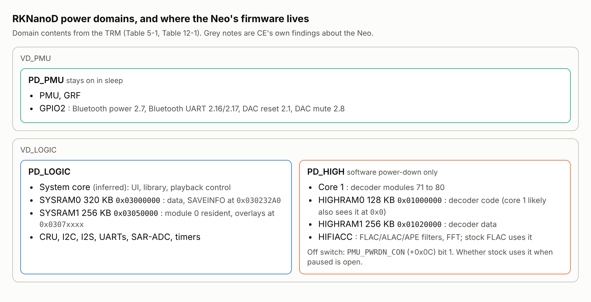

# What the RKNanoD reference manual settles for CE

Rockchip's "RKNanoD Technical Reference Manual", revision 1.0 (May 2015,
28 chapters), is public. Firefly, a Rockchip board partner, published it
for its Fireduino board:
<https://www.t-firefly.com/images/0/0b/Fireduino_MCU_TRM.pdf>. It is also
listed at <https://rockchip.fr/>. Rockchip holds the copyright, so this
repository cites it and does not copy it.

Until now CE's register facts came from disassembly, NeoPod, the
datasheet and the leaked SDK. This note records what the TRM adds, with
chapter references, and which CE document each fact supports or closes.

**Provenance caveat.** Neither host would serve the PDF to the
environment that wrote this note. The text below comes from the
document's indexed text, read through a fetch service. Tables and prose
came through cleanly. The address-map figure (Fig 2-1) did not: its
labels and addresses arrive interleaved, so only its unambiguous parts
are used, and they are marked. Nobody has recorded a SHA-256 for the PDF
yet. The first person to download it should add one here.

## Power domains (chapter 5)

- Two voltage domains, `VD_PMU` and `VD_LOGIC`, and three power domains
  (5.1.1, Table 5-1).
- `PD_PMU` holds the PMU, the GRF and **GPIO2**. GPIO2 carries the Neo's
  Bluetooth module power (GPIO2.7), the DAC reset and mute lines and the
  Bluetooth UART pins (`analysis/neopod_xref.md` B8, B11). So those pins
  stay powered when the logic domain sleeps.
- `PD_HIGH` holds core 1 (the decoder core), HIFIACC, and the HIGHRAM
  banks (Table 5-1, "core 1, HIFIACC and HIRAM, HDRAM"). It is powered
  down only by software (5.6.3) through `PMU_PWRDN_CON` (PMU offset
  `0x0C`) bit 1, `pd_high_pwrdwn_en`; `PMU_INT_ST` (offset `0x34`) bit 6
  reports `cal_core_sleep_status`.
- The recommended power modes (5.6.1) say `PD_HIGH` may be powered off in
  normal mode to save power.

For CE this turns item 3 of `power_and_features.md` into a concrete
question: does stock power `PD_HIGH` down when playback is paused or
stopped? If it does not, a patch could, at the cost of reloading the
decoder image on resume. That is a hardware-measurement question; no
patch is proposed here.

## Memory (chapters 2 and 12)

- Table 12-1 confirms CE's map: SYSRAM0 `0x03000000-0x0304FFFF` (320 KB)
  and SYSRAM1 `0x03050000-0x0308FFFF` (256 KB) in `PD_LOGIC`; HIGHRAM0
  `0x01000000-0x0101FFFF` (128 KB) and HIGHRAM1 `0x01020000-0x0105FFFF`
  (256 KB) in `PD_HIGH`.
- Every SRAM is built from 32 KB sub-blocks whose clocks can be gated
  separately (12.1, `CRU_CLK3_CON` to `CRU_CLK7_CON`). The datasheet
  (rev 1.8) says 64 KB banks; the TRM's 32 KB is the more specific
  figure.
- Boot remap: `GRF_SOC_CON0` bit 8 (`noc_remap`) maps either the boot ROM
  or the PMU SRAM at `0x00000000` for the system core (2.1, 4.2.2).
- Likely, from the garbled Fig 2-1: in the calculation core's view,
  HIGHRAM0 also appears at `0x00000000`. That explains why decoder
  modules 71 to 80 have reset vectors such as `0x0000298D` while loading
  at `0x01000000`, the open row in `platform_architecture.md`. CE's
  harness already maps decoder code at both addresses
  (`patches/harness/harness.py`, "core-1's local 0-based view").

## Decode accelerators (chapters 26 to 28)

- HIFIACC (26.1) is "a fixed point accelerator, including functions of
  FFT, MAC and LPC", used "for special APE, ALAC and FLAC decode". FFT and
  IFFT of 64 to 1,024 points; MAC 32x32 to 64 bits over 1 to 1,024 terms;
  FLAC and ALAC filters of order 1 to 32; APE for compression levels
  2000 to 5000 (version 3990) and 2000 to 4000 (3970); "192k * 24bit
  sample rate, under clock 300MHZ" for APE.
- SYNTH (chapter 27) and Imdct36 (chapter 28) are the MP3 synthesis and
  IMDCT blocks.
- The TRM gives no HIFIACC register map. echo-mini-newfw's MIT-licensed
  `docs/HIFIACC.md` reconstructs one and places the block at
  `0x01060000`, which is the "audio block" CE's harness found the stock
  FLAC decoder writing (`patches/harness/milestone2.md` Finding 3).
- The APE line matters for clock table v1, which runs APE at 288 MHz and
  lists its load as unmeasured (`patches/clock_v1/clock_v1.md` flag 3).
  Rockchip's own figure for the worst case APE stream is 300 MHz with the
  accelerator. That suggests 288 MHz may be tight for 192/24 APE and is
  more reason to run the hardware gate on APE first. It is a vendor
  claim, not a measurement of the Neo's decoder.

## Clocks (chapter 3)

- The CRU generates every internal clock from the PLL, the 24 MHz
  crystal or the USB PHY's 480 MHz (3.3, Fig 3-2). The calculation
  core's clocks (`hclk_cal_core`, `stclk_cal_core`, `fclk_cal_core`) sit
  in `PD_HIGH` in that figure. These are the B-core fields of the clock
  table CE decoded in `clock_table.md`.
- Divider registers follow one pattern, `clk = clk_src / (div_con + 1)`,
  with `CRU_CLKSEL0_CON` at CRU offset `0x14` (3.7.2).

## Serial buses (chapters 22 and 23)

- UART: six controllers, each with 32-byte FIFOs; UART1 and UART2 have
  auto flow control. Baud rate is `sclk / (16 x divisor)` (23.1.1,
  23.4.2). UART1 can be clocked from the 24 MHz crystal, the PLL or the
  USB PHY; the others from the crystal or the PLL, divided by 1 to 64
  (23.6.3).
- I2C: master only, up to 400 kbit/s, with
  `SCL = PCLK / (8 x ((CLKDIVL + 1) + (CLKDIVH + 1)))` (22.1.1, 22.3.2).
  The CS43198 accepts 1 MHz I2C, so the SoC side sets the DAC bus limit.

## Battery measurement (chapter 17)

The SAR-ADC has 8 single-ended channels, 10 bits, up to 100 kSPS with a
1 MHz converter clock, referenced to its supply (17.1.1). That bounds the
battery reading CE's status icon and battery-profile work depend on:
10 bits across the supply range, so any percentage curve is only as fine
as the board's divider allows.

## Interrupts and DMA (chapter 2)

Table 2-1 lists interrupt sources (`int1` is `synth_int`, `int6`
`dmac_int`); Table 2-2 lists DMA requests. DMAC1 has six channels and
DMAC2 two (1.1). newfw places DMAC2 at `0x01070000` with HIFIACC's
requests on it.
