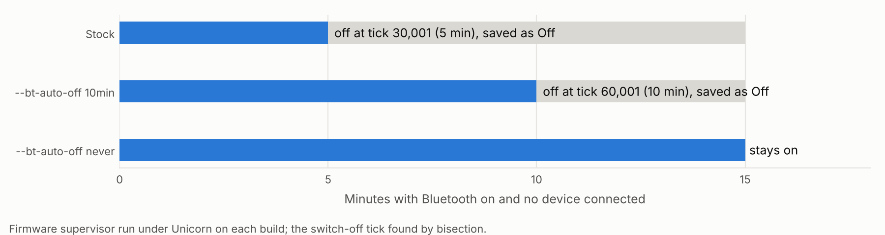

# Bluetooth auto-off option

Stock firmware turns Bluetooth off after 5 minutes with no device
connected. It also clears the Bluetooth byte in the saved settings, so
the menu reads Off, and once settings are saved it should stay off after
a restart (inferred from the byte; not observed on a device). Switch
your headphones off for a while and the player drops back to wired
output. One owner has asked Fosi for Bluetooth to "stay selected" (Audio
Science Review, 2026-11-03); this behaviour is a likely cause.

This option keeps the behaviour but lets a build lengthen the limit to
10 minutes or remove it. One patch, four bytes.



## What stock does

Module 0's Bluetooth supervisor (`0x03065FD4`) runs from the system
loop. With Bluetooth on (SAVEINFO `+0x2D4` = 1) and no link (`+0x2D3` =
0), it does this:

```
0x030661D8  ldr.w  r0, [r8]          ; tick at 0x03023298
0x030661DC  ldr    r1, [r5, #0x10]   ; last time a device was connected
0x030661DE  subs   r0, r0, r1
0x030661E0  movw   r1, #0x7530       ; 30,000 ticks   <- 10min patch
0x030661E4  cmp    r0, r1
0x030661E6  bls.w  0x030660C0        ; still within the limit  <- never patch
0x030661EA  movw   r0, #0x1CB
0x030661EE  bl     0x0306727E        ; clear event flag 0x1CB
0x030661F2  strb.w r4, [r6, #0x2D3]  ; link := 0
0x030661F6  strb.w r4, [r6, #0x2D4]  ; Bluetooth := off
            ...                      ; GPIO2.7 low: module powered down
```

- **The tick is 10 ms.** The screen-off timer reads the same counter and
  scales its table of 10, 20, 30, 60, 300 and 600 seconds by 100
  (`0x03064A1E..0x03064A26`). So 30,000 ticks is 5 minutes.
- **`+0x2D3` is the link state.** Module 0's reply parser sets it to 1
  when the Bluetooth module answers a `CQ` query with `O` or `o`, and to
  0 on `S`, `L`, `I` or a `CT` frame (`0x03065AA8..0x03065B4C`). NeoPod's
  independent driver reads the same replies the same way: `O` connected,
  `S`/`L`/`I` not connected, `CT` disconnected. While a device is
  connected the supervisor refreshes the timestamp, so the limit only
  counts time without a connection.

## The options

| `--bt-auto-off` | Patch | Change |
|---|---|---|
| (none) | | 30,000 ticks, 5 minutes (stock) |
| `10min` | `0038-bt-auto-off-10min.patch` | `movw r1, #0xEA60`: 60,000 ticks, 10 minutes |
| `never` | `0039-bt-auto-off-never.patch` | `bls.w` becomes `b.w` to the same target: never fires |

Ten minutes is the largest whole number of minutes a `movw` immediate
holds. `never` leaves the Bluetooth module powered while unpaired; its
idle current has not been measured, so the battery cost is unknown.

```sh
python3 patches/framework/build.py --bt-auto-off never --output out/ce-bt.img
python3 patches/full/build/build_full.py --ecpatch-dir DIR --bt-auto-off never
```

The browser builder has the same choice as a menu. It combines with the
DAC filter option and the Bluetooth long-press shortcut (patch 0032),
which hooks a different routine.

## Evidence

- `emu_supervisor.py` runs the supervisor from its entry under Unicorn,
  every call stubbed, and reports the two SAVEINFO bytes afterwards.
  `test_bt_auto_off.py` builds each option and runs it:

  ```
  ticks without a connection     stock   10min   never
          0 (   0.0 min)              on      on      on
      29999 (   5.0 min)              on      on      on
      30001 (   5.0 min)             OFF      on      on
      59999 (  10.0 min)             OFF      on      on
      60001 (  10.0 min)             OFF     OFF      on
   10000000 (1666.7 min)             OFF     OFF      on
  ```

  With a device connected, Bluetooth stays on in every build.
- `verify.py` check 15: each option changes only its four bytes plus the
  trailer CRC, and `--recovery` refuses the flag.
- `tests/builder.test.mjs`: the browser builder matches `build.py` byte
  for byte for both options and for both new options together. In the
  everything image each option also changes only its bytes, and the
  supervisor emulation gives the same 5 / 10 / never result there.

Not tested on a device. The supervisor also clears event flag `0x1CB`
when the limit fires (`0x0306727E` is the clear helper,
`analysis/event_flags.md`); what sets that flag has not been traced. With
`never` the clear simply does not happen on this path.
