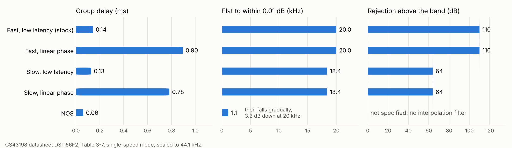

# DAC digital filter option

The Neo's CS43198 DAC has five interpolation filters. Stock firmware can
select any of them but never offers the choice, so every unit plays
through the chip's default. This option lets a build use one of the
other four. It changes one byte.



## What stock does

The DAC init at `0x0305175E` (module 0) writes register `0x090000`, PCM
Filter Option, from the settings byte at `0x030232A0 + 0x2E3`:

```
0x0305180E  ldrb.w r0, [r4, #0x2e3]
0x03051812  cbnz   r0, ...
0x03051814  movs   r1, #0x02        <- mode 0, the value every unit gets
0x03051816  mov.w  r0, #0x90000
0x0305181A  bl     dac_write
            ... mode 1: 0x42, mode 2: 0x82, mode 3: 0xC2, mode 4: 0x22
```

A scan of the image finds five loads of that byte, all in this routine,
and no store. No settings string mentions a filter. So the selector is
reachable in code but not from any menu, and the byte stays 0 (likely;
a store through another base register would not show in the scan).

Datasheet DS1156F2 section 7.5.2 defines the bits: 7 slow roll-off, 6
linear phase (phase compensated), 5 NOS, 1 high-pass filter, 0
de-emphasis. Stock's five values are exactly the chip's five filters,
each with the DC high-pass on and de-emphasis off.

| Option | Value | Patch |
|---|---|---|
| Fast roll-off, low latency (stock) | `0x02` | none |
| Fast roll-off, linear phase | `0x42` | `0034-dac-filter-fast-linear-phase.patch` |
| Slow roll-off, low latency | `0x82` | `0035-dac-filter-slow-low-latency.patch` |
| Slow roll-off, linear phase | `0xC2` | `0036-dac-filter-slow-linear-phase.patch` |
| Non-oversampling (NOS) | `0x22` | `0037-dac-filter-nos.patch` |

## The change

Each patch rewrites the mode-0 immediate at `0x03051814` (file
`0x2AEC0`), so mode 0 writes the chosen filter. Modes 1 to 4 keep their
stock values. The value is one that stock code already writes in its
own branch, so the DAC never sees a register value stock could not
produce.

The init runs once per playback session, after a DAC reset, with the
volume registers still muted. That is why the datasheet's pop-free NOS
sequence (section 5.8) is not needed here: the filter is set before any
audio plays. The same init serves USB DAC mode, so the choice applies
there too.

## Building

```sh
python3 patches/framework/build.py --dac-filter nos --output out/ce-nos.img
python3 patches/full/build/build_full.py --ecpatch-dir DIR --dac-filter nos
```

The choices are `fast-linear-phase`, `slow-low-latency`,
`slow-linear-phase` and `nos`. Leaving the flag off keeps stock's filter
and reproduces the published images. The browser builder in `docs/` has
the same choice as a menu.

## Evidence

- `test_dac_filter.py` runs the firmware's own filter-selection code
  (`0x0305180C` to `0x03051866`) under Unicorn for stock and each build,
  with the settings byte set to 0 through 5, and checks the value passed
  to `dac_write`:

  ```
  image                 mode 0  mode 1  mode 2  mode 3  mode 4  mode 5
  stock                 0x02    0x42    0x82    0xC2    0x22     --
  fast-linear-phase     0x42    0x42    0x82    0xC2    0x22     --
  slow-low-latency      0x82    0x42    0x82    0xC2    0x22     --
  slow-linear-phase     0xC2    0x42    0x82    0xC2    0x22     --
  nos                   0x22    0x42    0x82    0xC2    0x22     --
  ```

- `verify.py` check 14: each build differs from the default by exactly
  that byte plus the trailer CRC, and `--recovery` refuses the flag.
- `tests/builder.test.mjs`: the browser builder reproduces `build.py
  --dac-filter` byte for byte for all four filters. In the everything
  build each filter also changes only that byte and the CRC.

Not tested: any of this on a device. Whether the audible difference is
noticeable is a matter of taste; the measurable differences are the
datasheet's, shown in the figure. NOS in particular drops the treble by
up to 3.2 dB at 20 kHz for 44.1 kHz material and has no interpolation
filter to remove images above the band.

## Not done

A settings menu item would let users switch on the device. That needs a
free settings item and string, which CE has not found (the same gap that
blocks battery profiles), and `+0x2E3` sits outside the SAVEINFO block
known to survive a reboot (`analysis/saveinfo_lock.md` section 1.6).

`render_figure.py` draws `media/dac_filters.png` from the datasheet's
Table 3-7 values.
