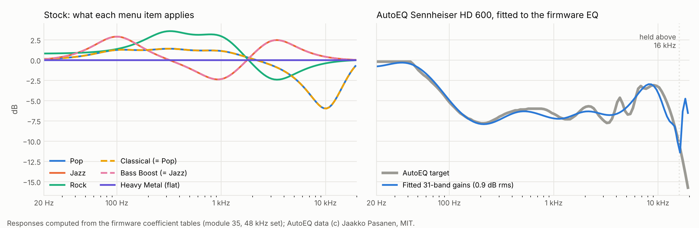

# EQ presets: AutoEQ and custom curves

The Neo's EQ is better hardware than its presets suggest. It is a
31-band graphic EQ on the ISO third-octave centres, 20 Hz to 20 kHz,
each band −12 to +12 dB in 1 dB steps. Stock presets use five of the
bands, and three of the six menu items don't do what their names say.
This option fixes that and loads AutoEQ or custom curves into the
presets.



## How the stock EQ works

| Part | Where | What |
|---|---|---|
| Menu | SAVEINFO `+0x68` | Off, Pop, Jazz, Rock, Classical, Bass Boost, Heavy Metal as 0 to 6 (`analysis/saveinfo_lock.md`) |
| Mode | module 33 data `0x030368D0` | menu index → EQ mode, identity for 0 to 7 |
| Selector | module 33 `0x0308ACF8` | mode → 31-entry gain array; entry = dB + 12 |
| Presets | module 33 data `0x030489CC` + 62 × k | gain arrays |
| Setup | module 36 `0x0308BED4` | copies each band's biquad for its gain from module 35 |
| Coefficients | module 35 data | 31 bands × 25 gains × 5 coefficients, for 11.025, 22.05, 32, 44.1 and 48 kHz; bands 0 to 9 Q20 32-bit, bands 10 to 30 Q13 16-bit with a gain factor |

Every band was checked by computing its response from the table: centre
within 4% of the ISO frequency, exactly ±12 dB at the extremes, 1 dB per
step. The bands are broad, about two octaves wide, so neighbours add up:
−6 dB on every band gives about −44 dB. That is why a curve cannot be
copied band by band; it has to be fitted.

**Stock bug.** Under Unicorn, the selector gives Classical Pop's array,
Bass Boost Jazz's array, and Heavy Metal a flat array. The jump-table
entries for modes 4, 5 and 6 point at the wrong cases. Two more preset
arrays in the table are never selected.

## The option

```sh
python3 patches/framework/build.py --eq-presets my-eq.json --output out/ce-eq.img
```

```json
{"slots": {
  "1": {"file": "Sennheiser HD 600 GraphicEQ.txt"},
  "6": {"text": "4 4 4 4 3 3 2 1 0 0 0 0 0 0 0 0 0 0 0 0 0 0 0 0 0 0 0 0 0 0 0"},
  "3": {"gains": [0, 0, 0, ... 31 integers]}
}}
```

Slots 1 to 6 are Pop, Jazz, Rock, Classical, Bass Boost and Heavy Metal.
A slot takes an AutoEQ `GraphicEQ.txt` (the Equalizer APO export on
autoeq.app), 31 dB values for a custom curve, or 31 integer gains to use
as they are. The browser builder has six boxes that take the same text.

The build:

1. fixes the selector (three jump-table bytes at `0x0308AD08`) so menu
   item *n* reads array *n*;
2. writes each configured slot;
3. writes what stock already applied into any slot you leave out, so an
   unconfigured item sounds exactly as it did.

Menu names stay the same; the README of your build is the only record of
which curve sits under which name.

## Fitting

`eqfit.py` (and its browser port `docs/eq-core.mjs`) fits each curve to
the firmware's own 48 kHz band responses on a 1/12-octave grid: a ridge
least-squares start, then ±1 dB coordinate descent. Above 16 kHz the fit
holds the curve level, because the top of a headphone measurement is the
least repeatable part and AutoEQ targets there often fall below the
−12 dB floor. The build report and the builder status give the fit error
and the peak gain. A peak above 0 dB can clip on loud tracks; AutoEQ's
`GraphicEQ` files are normalised to stay at or below 0 dB.

The Sennheiser HD 600 example (`fixtures/`, AutoEQ, MIT) fits at 0.92 dB
rms. Most of that is above 15 kHz, where up to 5 dB remains near 18 kHz.

## Evidence

- `test_eq_presets.py` runs stock's selector under Unicorn, shows the
  duplicate presets, checks that a build with nothing configured applies
  exactly stock's gains for every item, and checks that the example lands
  in its slots with under 1 dB rms fit error.
- `tests/builder.test.mjs`: the browser fit gives the same gains as
  Python, and the browser image equals `build.py --eq-presets example.json`
  byte for byte.

Not tested on a device. The 44.1 kHz coefficient set is the one used
for most music; the fit uses the 48 kHz set, whose bands sit at the same
frequencies within a few hertz.
